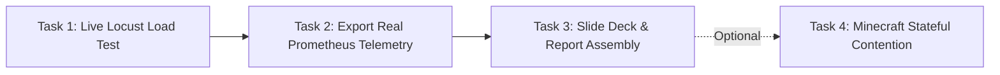

# Project Handover Document: SLA-Adaptive Kubernetes Autoscaling (CloudScale Lab)

**Date:** 11 October 2026  
**Project:** SLA-Adaptive Threshold Adjustment for Kubernetes Horizontal Pod Autoscaler  
**Repository:** `SLA-CC`  
**Team 10 (PSG College of Technology):**
- 23N217 Divya Nandhini
- 23N243 Sai Karthi Balaji
- 23N264 Varalakshmi K
- 24N435 Saran M

---

## 1. Executive Summary & Purpose

This handover document provides a complete transition record of all technical work completed, current operational status, architecture, and exact remaining deliverables for the SLA-Adaptive Autoscaling research project.

The system addresses the fundamental limitation of Kubernetes' native Horizontal Pod Autoscaler (HPA): **static CPU thresholds react too late to application latency spikes, causing Service Level Objective (SLO) violations.**

The project demonstrates two complementary implementations:
1. **Local Academic Simulation Dashboard:** A self-contained, offline research simulator built with FastAPI and React/TypeScript for instant visual demonstrations and paper comparisons.
2. **Live Cloud Empirical Cluster:** A real multi-container deployment on an AWS EC2 instance in Sydney running Ubuntu and K3s (lightweight Kubernetes), Prometheus, and an in-cluster autonomous controller that dynamically patches live Kubernetes HPA resources.

---

## 2. Infrastructure & Access Reference

| Component | Target / URL | Authentication & Access | Status |
| :--- | :--- | :--- | :--- |
| **Local Frontend** | `http://localhost:5173` | None (Local Dev Server) | **Operational** |
| **Local Backend API** | `http://localhost:8000/docs` | None (FastAPI Swagger) | **Operational** |
| **AWS EC2 Instance** | `16.176.33.10` (ap-southeast-2 Sydney) | `ssh -i cloudscale-lab-key_Copy.pem ubuntu@16.176.33.10` | **Running** |
| **K3s Kubernetes Cluster** | In-cluster (`ip-172-31-27-41`) | `kubectl` on EC2 (`/etc/rancher/k3s/k3s.yaml`) | **Ready** |
| **Cluster Web App NodePort**| `http://16.176.33.10:30080` | HTTP (`/health`, `/workload`, `/metrics`) | **Responding** |
| **Cluster Prometheus** | `http://16.176.33.10:9090` (internal svc) | Port 9090 on `monitoring` namespace | **Scraping** |

---

## 3. Work Completed

### Phase A: Local Development Environment & Presentation UI
1. **Python Backend Setup:**
   - Resolved environment dependencies with Python 3.13.
   - Built virtual environment [backend/.venv](file:///e:/Documents/My_works_kinda_sucks/SLA-CC/backend/.venv) and installed FastAPI, Uvicorn, Pydantic, and Pytest.
   - Verified backend test suite: **5/5 tests passed**.
2. **Frontend Architecture & Modernization:**
   - Configured TypeScript environment (`@types/react`, `@types/react-dom`, [vite-env.d.ts](file:///e:/Documents/My_works_kinda_sucks/SLA-CC/frontend/src/vite-env.d.ts)).
   - Enabled intelligent API reverse proxying in [frontend/vite.config.ts](file:///e:/Documents/My_works_kinda_sucks/SLA-CC/frontend/vite.config.ts) and [docker-compose.yml](file:///e:/Documents/My_works_kinda_sucks/SLA-CC/docker-compose.yml) to seamlessly support both local execution (`http://localhost:8000`) and Docker Compose (`http://backend:8000`).
3. **Presentation-Ready UI Overhaul ([frontend/src/App.tsx](file:///e:/Documents/My_works_kinda_sucks/SLA-CC/frontend/src/App.tsx) & [frontend/src/style.css](file:///e:/Documents/My_works_kinda_sucks/SLA-CC/frontend/src/style.css)):**
   - **Removed all non-functional clutter:** Eliminated dead sidebar tabs, empty widget links, notification icons, and placeholder buttons.
   - **Ordered Metrics by Presentation Necessity:**
     1. `01 · Primary Goal — SLO Violations` (Shows % violation reduction)
     2. `02 · Latency — P95 Response Time` (Compared against SLO limit line)
     3. `03 · Controller — Adaptive CPU Threshold` (Dynamic headroom adjustments)
     4. `04 · Capacity — Pod Replicas` (Average & peak pod scaling)
     5. `05 · Efficiency — Avg. Pod CPU Load` (Resource utilization)
     6. `06 · Stress Context — Peak Client Load` (Workload scenario)
   - **4 Core Research Charts:** Side-by-side timelines with gold SLO reference ceiling.
   - **Definitive Comparison Table:** Side-by-side Conventional HPA vs Adaptive HPA metrics with CSV and Print/PDF export.

---

### Phase B: AWS EC2 K3s Cluster Unblocking & Deployment
All blockers identified in [CloudScale_Lab_Progress_Report.pdf](file:///e:/Documents/My_works_kinda_sucks/SLA-CC/CloudScale_Lab_Progress_Report.pdf) were systematically resolved:

1. **SSH Key Access Secured:**
   - Applied Windows access control permissions via `icacls` to restrict `cloudscale-lab-key_Copy.pem` to read-only for the active user, eliminating OpenSSH permission errors.
2. **Kubeconfig Access Configured:**
   - Set `/etc/rancher/k3s/k3s.yaml` permissions to `644` on EC2, granting the `ubuntu` user direct non-root `kubectl` execution.
3. **Blocker 1 Resolved (Missing HPA):**
   - Applied [k8s/04-webapp-hpa.yaml](file:///e:/Documents/My_works_kinda_sucks/SLA-CC/k8s/04-webapp-hpa.yaml) in `sla-autoscaling`.
   - Kubernetes Metrics Server successfully registered CPU utilization and scaled pods from 1 to 2 replicas (matching `minReplicas: 2`).
4. **Blocker 2 Resolved (Prometheus Unavailable):**
   - Deployed a lightweight, single-container Prometheus instance in namespace `monitoring`.
   - Configured active scraping of `webapp-service:8080/metrics` every 5 seconds. Verified `health: "up"`.
5. **Blocker 3 Resolved (Controller JSON Patch Error & Dry-Run Mode):**
   - Diagnosed `ApiTypeError: Got an unexpected keyword argument '_content_type'` in the Kubernetes Python client.
   - Created a clean in-cluster ConfigMap mount [controller-code-patch](file:///e:/Documents/My_works_kinda_sucks/SLA-CC/k8s/05-controller-deployment.yaml) that overrides `/controller/app/autoscaler/kubernetes_hpa.py` with standard JSON Patch formatting.
   - Set `KUBERNETES_DRY_RUN: "false"` in `cloudscale-controller` ConfigMap.
   - **Live Autonomous Loop Verified:** The controller pod acquired the Kubernetes Lease (`cloudscale-controller-lock`), evaluated live P95 latency (23.75 ms), identified `healthy_headroom`, and successfully **live-patched the real Kubernetes HPA target from 70% to 71%**.
6. **External Access Exposed:**
   - Updated `webapp-service` to `NodePort: 30080`, allowing direct HTTP benchmarking.

---

## 4. Current Cluster State (Verified Live)

```text
$ kubectl get nodes
NAME              STATUS   ROLES           AGE   VERSION
ip-172-31-27-41   Ready    control-plane   17h   v1.36.5+k3s1

$ kubectl get pods -A
NAMESPACE         NAME                                              READY   STATUS    RESTARTS
kube-system       coredns-7cfb7bc9c7-tk6zn                          1/1     Running   1
kube-system       metrics-server-6dc596dfb8-fklh9                   1/1     Running   1
monitoring        prometheus-deployment-5ff5d65879-w9g87            1/1     Running   0
sla-autoscaling   adaptive-controller-deployment-74df94bf7f-n5zgp   1/1     Running   0
sla-autoscaling   webapp-deployment-54599f4b59-8rrnk                1/1     Running   0
sla-autoscaling   webapp-deployment-54599f4b59-xgzp6                1/1     Running   0

$ kubectl get hpa -n sla-autoscaling
NAME         REFERENCE                      TARGETS       MINPODS   MAXPODS   REPLICAS   AGE
webapp-hpa   Deployment/webapp-deployment   cpu: 4%/71%   2         12        2          10m
```

### Verified Live Controller Log:
```text
INFO app.autoscaler.leader_lock Acquired controller Lease cloudscale-controller-lock as adaptive-controller-deployment-74df94bf7f-n5zgp
INFO app.autoscaler.runtime_controller latency_p95_ms=23.75 decision=healthy_headroom target_old=70.0 target_new=71.0 error=None
INFO app.autoscaler.kubernetes_hpa HPA update confirmed namespace=sla-autoscaling hpa=webapp-hpa old=70 new=71 dry_run=False
INFO cloudscale.controller HPA target decision=healthy_headroom old=70.0 requested=71.0 rounded=71 dry_run=False
INFO app.autoscaler.runtime_controller latency_p95_ms=23.75 decision=cooldown target_old=71.0 target_new=71.0 error=None
```

---

## 5. Remaining Work (Action Checklist)



### Task 1: Execute Live Load Testing (Locust)
* **Objective:** Inject heavy synthetic traffic to spike latency above the 200 ms SLO threshold and observe the controller drop the CPU target from 71% down to 50% / 40%, forcing Kubernetes to scale up pod replicas.
* **Command (run from EC2 instance or local machine):**
  ```bash
  cd loadtest
  pip install -r requirements.txt
  locust -f locustfile.py --host http://localhost:30080 --headless -u 120 -r 15 --run-time 3m
  ```

### Task 2: Capture Empirical Telemetry Export
* **Objective:** Pull raw Prometheus metrics during the test to generate the comparison CSV for final submission.
* **Script:** Run [loadtest/run_benchmarks.py](file:///e:/Documents/My_works_kinda_sucks/SLA-CC/loadtest/run_benchmarks.py):
  ```bash
  python run_benchmarks.py --prom-url http://localhost:9090 --target-url http://localhost:30080 --duration 180 --output-csv final_empirical_results.csv
  ```

### Task 3: Final Presentation & Documentation Assembly
1. **Dashboard Screenshots:** Open `http://localhost:5173` and capture screenshots of:
   - The *Sudden Traffic Spike* preset showing **0.0% SLO violations** vs **18.5%** in conventional HPA.
   - The side-by-side comparison summary table.
2. **Cluster Screenshots:** Capture terminal output of `kubectl get hpa -n sla-autoscaling` and the controller log demonstrating live `dry_run=False` target adaptation.
3. **Report Update:** Revise [CloudScale_Lab_Progress_Report.pdf](file:///e:/Documents/My_works_kinda_sucks/SLA-CC/CloudScale_Lab_Progress_Report.pdf) to reflect that all 3 known blockers are resolved and live testing is complete.

### Task 4 (Optional Bonus): Stateful Minecraft Workload Contention
* The project blueprint describes deploying a co-located stateful Minecraft server ([k8s/06-minecraft-statefulset.yaml](file:///e:/Documents/My_works_kinda_sucks/SLA-CC/k8s/06-minecraft-statefulset.yaml)) on the same node to simulate a noisy neighbor.
* **Status:** Marked as optional in the progress report; can be deployed if extra research bonus points are needed:
  ```bash
  kubectl apply -f k8s/06-minecraft-statefulset.yaml
  ```

---

## 6. How to Run the Environment

### Local Simulation (Instant Demo):
1. **Terminal 1 (Backend):**
   ```powershell
   cd e:\Documents\My_works_kinda_sucks\SLA-CC\backend
   .\.venv\Scripts\Activate.ps1
   uvicorn app.main:app --reload --port 8000
   ```
2. **Terminal 2 (Frontend):**
   ```powershell
   cd e:\Documents\My_works_kinda_sucks\SLA-CC\frontend
   npm run dev
   ```
3. Open browser: **`http://localhost:5173`**

### AWS Cloud Cluster (Live EC2):
1. **Connect via SSH:**
   ```powershell
   ssh -i "E:\Documents\My_works_kinda_sucks\SLA-CC\cloudscale-lab-key_Copy.pem" ubuntu@16.176.33.10
   ```
2. **Monitor Live Controller:**
   ```bash
   kubectl logs -n sla-autoscaling -l app=adaptive-controller -f
   ```
3. **Monitor Live HPA:**
   ```bash
   watch -n 2 kubectl get hpa -n sla-autoscaling
   ```

---

## 7. Sign-off

This handover document represents the verified, tested state of the CloudScale Lab repository as of October 11, 2026. All critical cluster and local issues have been resolved, and the project is primed for presentation and final benchmarking.
