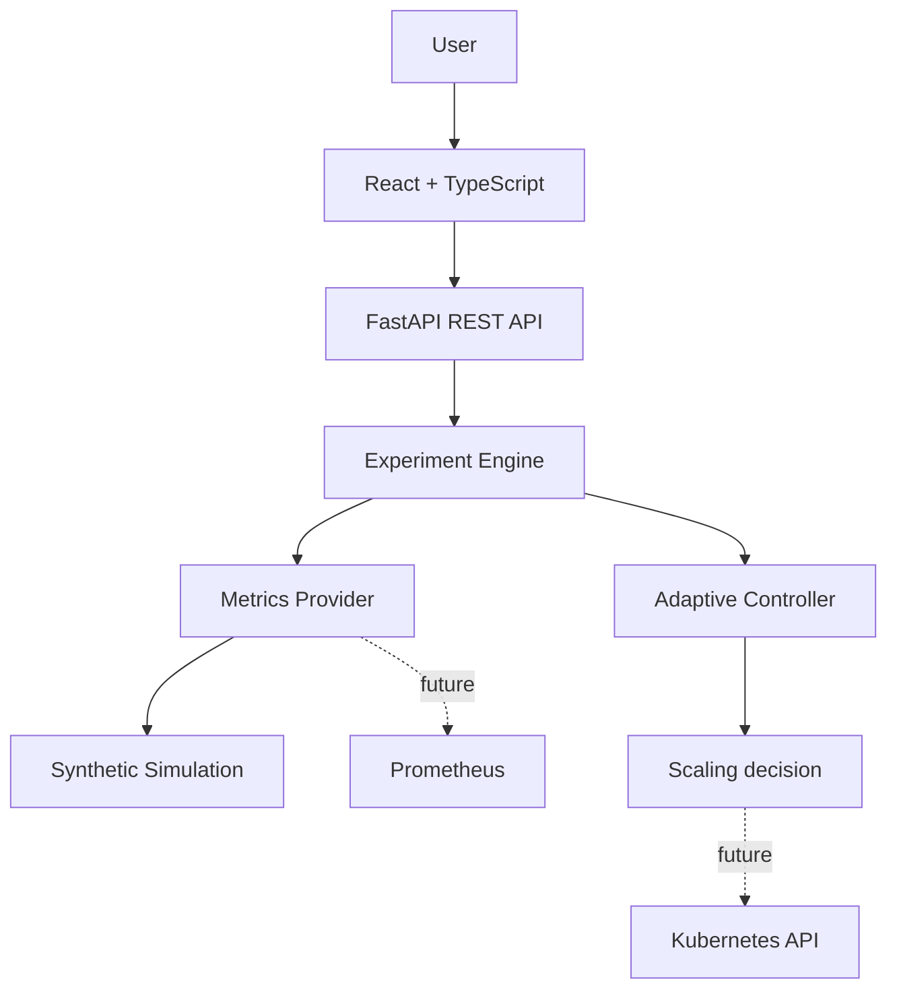

# CloudScale Lab

**SLA-Adaptive Kubernetes Autoscaling Research Platform** — a simulation-first academic prototype for exploring conventional fixed-target HPA against a simple SLO-aware adaptive controller. It works without a Kubernetes cluster.

> **Research integrity:** output is generated by a synthetic workload simulation. The controller is paper-inspired and transparent; it does not claim to reproduce a specific research paper or production Kubernetes behavior.

## Run locally

The simplest path is Docker Compose (Docker Desktop with Compose v2):

```bash
docker compose up --build
```

Open [http://localhost:5173](http://localhost:5173). The backend API and interactive docs are at [http://localhost:8000/api/health](http://localhost:8000/api/health) and [http://localhost:8000/docs](http://localhost:8000/docs). SQLite data persists in the `cloudscale-data` volume.

Without Docker, run the backend in one terminal and frontend in another:

```bash
cd backend
python -m venv .venv
# Windows: .venv\Scripts\Activate.ps1
# macOS/Linux: source .venv/bin/activate
pip install -r requirements.txt
uvicorn app.main:app --reload --port 8000
```

```bash
cd frontend
npm install
npm run dev
```

## What is implemented

- Dark, responsive React and TypeScript research dashboard with live experiment charts.
- Synthetic constant, ramp, spike, sawtooth, and custom load profiles.
- Baseline HPA replica recommendation: `ceil(current replicas × CPU / target)` with bounds and simplified stabilization.
- Adaptive threshold controller responds to latency warning/critical bands and healthy headroom.
- Paired runs use identical deterministic users and seeded simulation noise.
- CPU, memory, request rate, response time, replica count, threshold, and SLO status per time step.
- Results saved to SQLite; CSV and JSON export; print-friendly report view.
- FastAPI REST API and Swagger docs.

## Adaptive algorithm

Start at the configured CPU target. At each time step, compare simulated latency to the SLO: at or above the critical multiplier lower the threshold by 1.5 decrease steps; above the warning multiplier lower it by one step; below 80% of SLO raise it by one increase step; otherwise hold. Clamp the result to the allowed minimum and maximum. This is a small, explainable paper-inspired design, not a literature reproduction.

## Architecture

See [architecture](docs/architecture.md), [methodology](docs/methodology.md), and the [experiment plan](docs/experiment-plan.md). In short:



## API

- `GET /api/health`, `GET /api/config`
- `POST /api/experiments`, `POST /api/experiments/compare`
- `GET /api/experiments`, `GET /api/experiments/{id}`
- `GET /api/experiments/{id}/export/csv`, `GET /api/experiments/{id}/export/json`

Each experiment accepts algorithm, workload, duration, user range, SLO, CPU threshold, and controller settings. `/docs` provides interactive API schemas.

## Tests

```bash
cd backend
pip install -r requirements.txt
pytest
```

Tests cover adaptive response/bounds/determinism, HPA scaling bounds, paired workload reproducibility, summaries, API persistence, and exports.

## Real infrastructure next steps

Simulation mode is explicitly reported by the API. Prometheus and Kubernetes are not contacted, and no credentials are needed. To connect a private K3s environment, implement a metrics provider using Prometheus queries, then an autoscaling provider using the official Kubernetes Python client. Keep access credentials in environment or cluster identity, validate policy against a staging deployment, and compare measured metrics separately from synthetic runs. The `metrics` package is an initial provider boundary; direct HPA updates and cluster credentials are intentionally not implemented.
