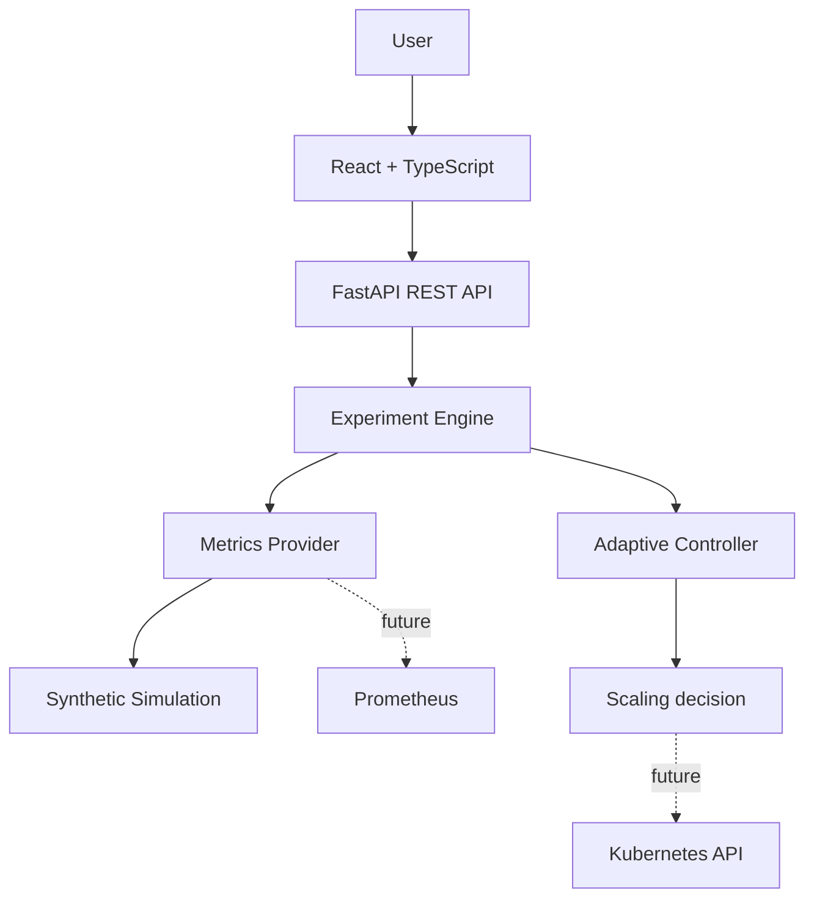

# CloudScale Lab

**SLA-Adaptive Kubernetes Autoscaling Research Platform** — a simulation-first academic prototype for exploring conventional fixed-target HPA against a simple SLO-aware adaptive controller. It works without a Kubernetes cluster.

> **Research integrity:** output is generated by a synthetic workload simulation. The controller is paper-inspired and transparent; it does not claim to reproduce a specific research paper or production Kubernetes behavior.

## Run locally

The simplest path is Docker Compose (Docker Desktop with Compose v2):

```bash
docker compose up --build
```

Open [http://localhost:5173](http://localhost:5173). The backend API and interactive docs are at [http://localhost:8000/api/health](http://localhost:8000/api/health) and [http://localhost:8000/docs](http://localhost:8000/docs). SQLite data persists in the `cloudscale-data` volume.

Without Docker, run the backend in one terminal and frontend in another:

```bash
cd backend
python -m venv .venv
# Windows: .venv\Scripts\Activate.ps1
# macOS/Linux: source .venv/bin/activate
pip install -r requirements.txt
uvicorn app.main:app --reload --port 8000
```

```bash
cd frontend
npm install
npm run dev
```

## What is implemented

- Dark, responsive React and TypeScript research dashboard with interactive experiment charts.
- Synthetic constant, ramp, spike, sawtooth, and custom load profiles.
- Baseline HPA replica recommendation: `ceil(current replicas × CPU / target)` with bounds and simplified stabilization.
- Adaptive threshold controller responds to latency warning/critical bands and healthy headroom.
- Paired runs use identical deterministic users and seeded simulation noise.
- CPU, memory, request rate, response time, replica count, threshold, and SLO status per time step.
- Results saved to SQLite; CSV and JSON export; print-friendly report view.
- P50/P95/P99 summaries and UTC timestamps are stored for simulation steps; live-only measurements remain unreported until a cluster runner is connected.
- FastAPI REST API and Swagger docs.

## Adaptive algorithm

Start at the configured CPU target. At each time step, compare simulated latency to the SLO: at or above the critical multiplier lower the threshold by 1.5 decrease steps; above the warning multiplier lower it by one step; below 80% of SLO raise it by one increase step; otherwise hold. Clamp the result to the allowed minimum and maximum. This is a small, explainable paper-inspired design, not a literature reproduction.

## Architecture

See [architecture](docs/architecture.md), [methodology](docs/methodology.md), and the [experiment plan](docs/experiment-plan.md). In short:



## API

- `GET /api/health`, `GET /api/config`
- `POST /api/experiments`, `POST /api/experiments/compare`
- `GET /api/experiments`, `GET /api/experiments/{id}`
- `GET /api/experiments/{id}/export/csv`, `GET /api/experiments/{id}/export/json`

Each experiment accepts algorithm, workload, duration, user range, SLO, CPU threshold, and controller settings. `/docs` provides interactive API schemas.

## Tests

```bash
cd backend
pip install -r requirements.txt
pytest
```

Tests cover adaptive response/bounds/determinism, HPA scaling bounds, paired workload reproducibility, summaries, API persistence, and exports.

## Real infrastructure next steps

Simulation mode is explicitly reported by the API. The optional controller modules and manifests are a separate, opt-in starting point; they have not been verified against the project's K3s cluster. The supplied two-page PDF is a project proposal that states the goal and evaluation metrics, but does not include the underlying paper's algorithm or pseudocode. The runtime follows the explicit latency rules in the infrastructure plan, not a verified reproduction of the paper.

### Controller rule set

The Kubernetes runtime uses actual P95 latency from Prometheus. At or above 300 ms it lowers the CPU target by 7.5 points; from 240 ms to below 300 ms it lowers by 5 points; from 160 ms to below 240 ms it holds; below 160 ms it increases by 1 point. Values are clamped to 40–85%. After changing the target, it waits for the configured 60-second cooldown. Invalid, absent, and stale samples never count as healthy latency and never cause an update. The Kubernetes HPA still calculates desired replicas. This runtime is distinct from the demo simulator's controller rules.

### Optional K3s deployment (pending cluster verification)

Build the controller image and workload image separately. The workload image must be the existing application supplied by the team and expose `/metrics` with histogram buckets for `http_request_duration_seconds` (or configure `PROMETHEUS_P95_QUERY` for its actual metric). Do not invent or commit registry credentials.

```bash
docker build -f backend/Dockerfile.controller -t <your-registry>/cloudscale-controller:<tag> backend
docker push <your-registry>/cloudscale-controller:<tag>
export WORKLOAD_IMAGE=<your-registry>/<existing-workload>:<tag>
export CONTROLLER_IMAGE=<your-registry>/cloudscale-controller:<tag>
```

Create the namespace and apply the externally built workload. The web workload is ClusterIP-only. Build and verify its `/health` and `/metrics` endpoints before enabling monitoring.

```bash
kubectl apply -f k8s/00-namespace.yaml
envsubst < k8s/02-webapp-deployment.yaml | kubectl apply -f -
kubectl apply -f k8s/03-webapp-service.yaml
```

For a conventional baseline, apply only `k8s/04-webapp-hpa.yaml`. For adaptive mode, first remove the baseline, apply `k8s/04-webapp-hpa-adaptive.yaml`, then apply the controller RBAC and Deployment. Both HPA manifests intentionally target the same deployment and share the same HPA name; only one is applied at a time.

```bash
kubectl apply -f k8s/04-webapp-hpa.yaml
# When ready to test adaptive mode:
kubectl delete -f k8s/04-webapp-hpa.yaml --ignore-not-found
kubectl apply -f k8s/04-webapp-hpa-adaptive.yaml
kubectl apply -f k8s/01-rbac.yaml
envsubst < k8s/05-controller-deployment.yaml | kubectl apply -f -
```

The ConfigMap keeps `KUBERNETES_DRY_RUN=true` initially. Confirm Prometheus connectivity and query results before changing it to `false`; then apply the ConfigMap and restart the controller. Verify logs and the returned HPA target after each change. The controller Deployment has one replica and `Recreate` rollout strategy, plus a Kubernetes Lease single-writer lock; do not scale it up manually. Its Role is limited to reading and patching `webapp-hpa` and managing the named controller Lease in `sla-autoscaling`.

Only one HPA may own the workload at a time. Switch strategies by deleting the current HPA, confirming it is gone, and applying the other manifest:

```bash
kubectl scale deployment/adaptive-controller-deployment -n sla-autoscaling --replicas=0
kubectl delete -f k8s/04-webapp-hpa-adaptive.yaml --ignore-not-found
kubectl apply -f k8s/04-webapp-hpa.yaml
# To switch to adaptive, remove the conventional HPA before applying adaptive:
kubectl delete -f k8s/04-webapp-hpa.yaml --ignore-not-found
kubectl apply -f k8s/04-webapp-hpa-adaptive.yaml
kubectl scale deployment/adaptive-controller-deployment -n sla-autoscaling --replicas=1
```

Before enabling control, validate that K3s metrics-server is available, inspect `k8s/prometheus-scrape-job.yaml`, verify the workload `/metrics` output and Prometheus scrape target, and run the P95 query in Prometheus UI. The scrape snippet needs to be merged into the existing Prometheus configuration; it does not install Prometheus or Grafana. `k8s/07-servicemonitor.yaml` is an alternative only if Prometheus Operator CRDs are installed. Kubernetes service discovery also requires the existing Prometheus service account to be allowed to discover pods in the namespace. Tune CPU/memory requests to the real app because HPA CPU utilization is measured relative to requested CPU. The web workload uses ClusterIP; no Prometheus/Grafana endpoints or AWS resources are exposed by these manifests. The optional Minecraft StatefulSet is stateful and is not covered by the web Deployment HPA; do not scale it as though replicas share one game world.

No live K3s, Prometheus, registry, workload image, or AWS environment was available for this implementation pass. Treat those steps as pending verification.

Controller environment variables (also collected in `k8s/05-controller-deployment.yaml`):

| Variable | Default | Purpose |
| --- | --- | --- |
| `PROMETHEUS_URL` | `http://prometheus-server.monitoring.svc.cluster.local` | In-cluster Prometheus API base URL |
| `PROMETHEUS_P95_QUERY` | histogram query in ConfigMap | Configurable P95 latency query, result expected in milliseconds |
| `PROMETHEUS_TIMEOUT_SECONDS` | `3` | Query timeout |
| `SLO_MS` | `200` | Latency SLO in milliseconds |
| `INITIAL_CPU_TARGET` / `MIN_CPU_TARGET` / `MAX_CPU_TARGET` | `70` / `40` / `85` | Initial and bounded HPA CPU targets |
| `CONTROL_INTERVAL_SECONDS` | `10` | Controller polling interval |
| `COOLDOWN_SECONDS` | `60` | Minimum wait between actual threshold changes |
| `WARNING_MULTIPLIER` / `CRITICAL_MULTIPLIER` / `HEALTHY_MULTIPLIER` | `1.2` / `1.5` / `0.8` | SLO latency decision bands |
| `NORMAL_DECREASE` / `CRITICAL_DECREASE` / `INCREASE_STEP` | `5` / `7.5` / `1` | CPU target adjustment in percentage points |
| `MAX_METRIC_AGE_SECONDS` | `30` | Older Prometheus samples are rejected |
| `KUBERNETES_NAMESPACE` / `HPA_NAME` | `sla-autoscaling` / `webapp-hpa` | HPA lookup target |
| `KUBERNETES_DRY_RUN` | `true` | Use API dry-run until explicitly enabled after validation |
| `LEASE_NAME` / `LEASE_DURATION_SECONDS` | `cloudscale-controller-lock` / `30` | Single-writer Kubernetes Lease lock |
