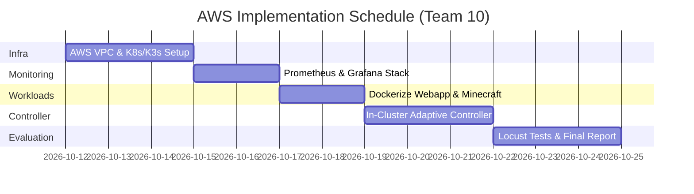

# SLA-Adaptive Autoscaling for Cloud Applications Using Kubernetes
## AWS Cloud Migration, Architecture & Full Implementation Blueprint

**Team 10:**
- 23N217 Divya Nandhini
- 23N243 Sai Karthi Balaji
- 23N264 Varalakshmi K
- 24N435 Saran M

**Reference Paper:** *SLA-Adaptive Threshold Adjustment for a Kubernetes Horizontal Pod Autoscaler*  
**Generated PDF Deliverable:** [SLA_Adaptive_Autoscaling_AWS_Implementation_Plan.pdf](file:///d:/STUDY/cloud/SLA-CC/docs/SLA_Adaptive_Autoscaling_AWS_Implementation_Plan.pdf)

---

## 1. Executive Summary & Codebase Gap Analysis

### 1.1 Current Implementation State (`SLA-CC`)
The current repository hosts **CloudScale Lab**, a simulation prototype consisting of:
- **FastAPI backend** (`backend/app/`): Simulates request rates, latencies, and replica responses deterministically based on synthetic traffic curves (sawtooth, spike, ramp, constant).
- **React/TypeScript UI** (`frontend/src/`): Renders live comparison charts and exports experiment CSV/JSON files.
- **Current Mode:** Pure simulation (`mode: "simulation"`). The Prometheus client and Kubernetes API calls are placeholder abstractions.

### 1.2 Target Cloud Implementation on AWS
The next phase transitions from simulation to an empirical AWS deployment:
1. Deploying a live Kubernetes cluster on AWS (**Option A: AWS EKS** or **Option B: AWS EC2 Multi-Node K3s**).
2. Implementing an in-cluster **Adaptive Controller Daemon** that queries live P95 latency from **Prometheus** via PromQL.
3. Dynamically patching live Kubernetes **HorizontalPodAutoscaler (HPA)** resources using the official Kubernetes Python API client.
4. Subjecting the system to live HTTP traffic from **Locust** and evaluating co-located resource contention with a stateful **Minecraft** server.

---

## 2. Architecture Comparison

| Component / Capability | Current Prototype (Simulation) | AWS Production Target (Next Implementation) |
| :--- | :--- | :--- |
| **Orchestration** | In-memory mathematical engine | AWS EKS or AWS EC2 Ubuntu K3s (v1.28+) |
| **Telemetry** | Formula with seeded random noise | Prometheus scraping `/metrics` & cAdvisor via PromQL |
| **Workload** | Synthesized response time curves | Containerized HTTP microservice + Stateful Minecraft Server |
| **Autoscaling** | Calculated during loop simulation | Live K8s HPA patched dynamically via Python API |
| **Load Injection** | Precalculated user array | Distributed Locust on AWS generating live HTTP traffic |
| **Dashboard** | Recharts via local SQLite | CloudScale Lab UI + Grafana connected to AWS endpoints |

---

## 3. AWS Infrastructure Options & Cost Analysis

### Option A: AWS EKS (Amazon Elastic Kubernetes Service) - Enterprise Managed
- **Control Plane:** AWS EKS Managed Control Plane ($0.10/hr = ~$73/month).
- **Worker Nodes:** Managed Node Group with 2x `t3.medium` instances (2 vCPU, 4GB RAM) in private subnets with NAT Gateway.
- **Networking & Storage:** AWS ALB Controller + Amazon EBS gp3 CSI Driver.
- **Estimated Total Cost:** ~$135 / month.

### Option B: Multi-Node K3s on AWS EC2 - Recommended Academic Choice
- **Control Plane:** 1x `t3.medium` instance running K3s server + Prometheus + Grafana.
- **Worker Node:** 1x `t3.medium` instance running application pods & the Minecraft server.
- **Locust Node:** 1x `t3.small` instance outside the cluster generating client requests.
- **Estimated Total Cost:** **~$25 - $35 / month** (or ~$12/month using Spot instances).
- **Benefit:** 100% Kubernetes API and HPA compatibility with zero EKS management fees.

---

## 4. SLA-Adaptive Controller Formulation

The controller executes an autonomous control loop every $\Delta t = 10\text{s}$:

$$T_{\text{cpu}}(t+1) = \begin{cases} 
\max(T_{\min}, T_{\text{cpu}}(t) - 1.5 \times \delta_{\text{down}}) & \text{if } R_{p95}(t) \ge 1.5 \times \text{SLO} \quad \text{(Critical Violation)} \\
\max(T_{\min}, T_{\text{cpu}}(t) - \delta_{\text{down}}) & \text{if } 1.2 \times \text{SLO} \le R_{p95}(t) < 1.5 \times \text{SLO} \quad \text{(Warning Buffer)} \\
T_{\text{cpu}}(t) & \text{if } 0.8 \times \text{SLO} \le R_{p95}(t) < 1.2 \times \text{SLO} \quad \text{(Stable Region)} \\
\min(T_{\max}, T_{\text{cpu}}(t) + \delta_{\text{up}}) & \text{if } R_{p95}(t) < 0.8 \times \text{SLO} \quad \text{(Healthy Headroom)}
\end{cases}$$

**Parameters:**
- Initial Target: $70\%$
- Operating Range: $[T_{\min} = 40\%, T_{\max} = 85\%]$
- Step Sizes: $\delta_{\text{down}} = 5\%$, $\delta_{\text{up}} = 1\%$ (asymmetric damping favoring safety)
- Cooldown Stabilization: 60 seconds

---

## 5. Implementation Roadmap (Phases 1 - 5)

1. **Phase 1: AWS Cluster Setup (Days 1 - 2):** Launch EC2 / EKS instances, initialize Kubernetes cluster, and deploy Metrics Server.
2. **Phase 2: Observability Pipeline (Days 3 - 4):** Deploy `kube-prometheus-stack` via Helm and configure scraping intervals.
3. **Phase 3: Workload Deployment (Days 5 - 6):** Deploy target web microservice with resource requests/limits + stateful Minecraft server with EBS gp3 PVC.
4. **Phase 4: Adaptive Controller Daemon (Days 7 - 9):** Implement the in-cluster Python controller with RBAC permissions to dynamically patch HPA targets.
5. **Phase 5: Locust Benchmarking & Final Deliverables (Days 10 - 12):** Execute paired comparison tests, export time-series metrics, and generate the final report.
